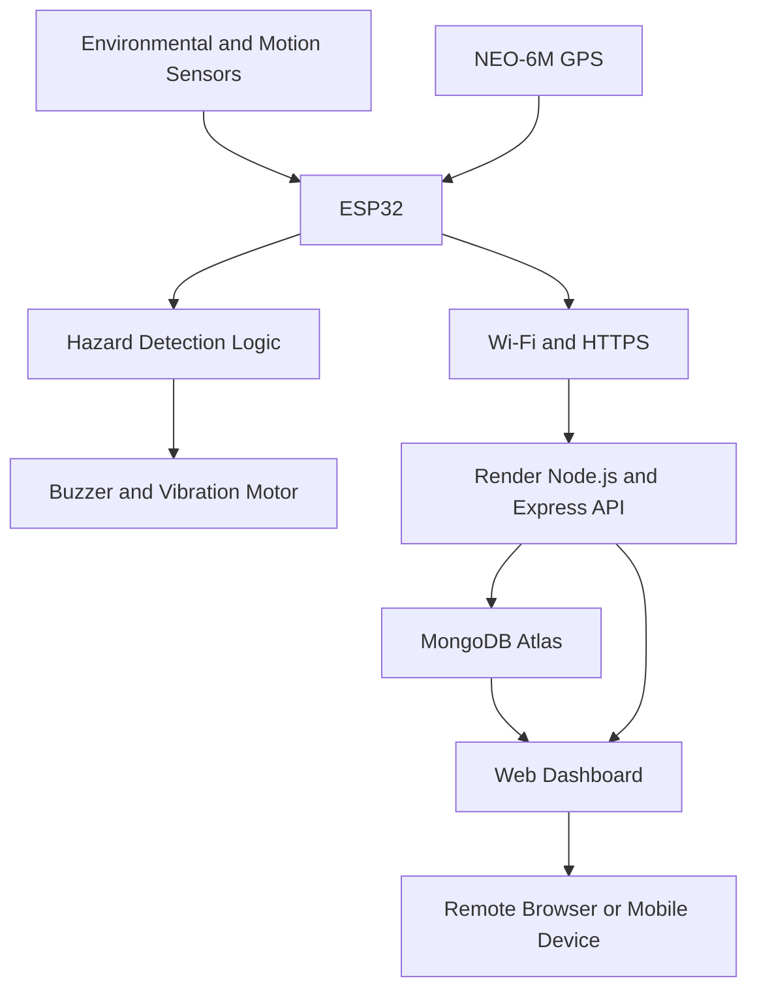

# StrideGuard — ESP32 Smart Shoe Safety System

**An IoT-based wearable safety system for real-time hazard detection, motion monitoring, GPS tracking, and remote sensor visualization.**

**Live Dashboard:** https://smart-shoe.onrender.com/
---
## 1. Project Overview

StrideGuard is an ESP32-based IoT smart shoe safety prototype designed to identify potential environmental and movement-related hazards and transmit sensor readings to a remotely accessible web dashboard.

The system combines embedded electronics, multiple sensors, GPS positioning, local audio and vibration alerts, a Node.js backend, and a MongoDB database.

The ESP32 reads the connected sensors, evaluates configured hazard conditions, activates local alerts when necessary, and sends telemetry to the backend over Wi-Fi. The web dashboard presents the received data for remote monitoring.

The application is deployed on Render, allowing the website and backend to be accessed through a public URL without requiring the development laptop to host the application continuously.

### Key objectives

- Monitor environmental conditions around the wearer.
- Detect configured obstacle, gas, wet-surface, and fall-related conditions.
- Provide immediate local alerts using a buzzer and vibration motor.
- Obtain GPS coordinates when a valid GPS fix is available.
- Transmit sensor readings to a cloud-accessible backend.
- Store telemetry in MongoDB for dashboard visualization and history.
- Provide a centralized interface for monitoring device data remotely.

## 2. System Architecture



### Data flow

1. Sensors collect distance, pressure, gas, moisture, and motion measurements.
2. The ESP32 reads sensor values and evaluates the programmed hazard conditions.
3. The buzzer and vibration motor provide local alerts according to those conditions.
4. GPS coordinates are included when a recent valid fix is available.
5. The ESP32 sends a JSON telemetry payload to the backend every five seconds.
6. The backend validates and processes incoming telemetry and persists it in MongoDB.
7. The dashboard displays available readings and associated device status.

The cloud-hosted backend and dashboard can operate independently of the development laptop. The ESP32 still requires power, Wi-Fi, and internet connectivity to transmit live measurements.

## 3. Hardware Components

| Component | Purpose |
|---|---|
| ESP32 DevKit / ESP32-WROOM development board | Main controller and Wi-Fi connectivity |
| HC-SR04 ultrasonic sensor | Measures distance to nearby objects |
| MPU6050-compatible IMU | Measures acceleration for motion monitoring |
| FSR 402 force-sensitive resistor | Measures pressure-related analog changes |
| MQ-2 gas sensor | Detects changes in combustible-gas/smoke-related sensor response |
| Moisture sensor | Provides an analog reading associated with surface moisture |
| NEO-6M GPS module | Provides geographic coordinates when satellite reception permits |
| Active buzzer | Provides an audible alert |
| Vibration motor | Provides a tactile alert |
| Breadboard and jumper wires | Prototyping and electrical connections |
| Battery and power circuitry | Supplies power to the prototype | 
| VL53L0X time-of-flight distance sensor | Measures distance to potholes 

## 4. ESP32 Pin Configuration

The current firmware uses the following GPIO assignments.

| Component / signal | ESP32 GPIO |
|---|---:|
| Buzzer | GPIO 23 |
| Vibration motor control | GPIO 19 |
| HC-SR04 Trigger | GPIO 25 |
| HC-SR04 Echo | GPIO 34 |
| FSR 402 analog output | GPIO 32 |
| MQ-2 analog output | GPIO 33 |
| Moisture sensor analog output | GPIO 27 |
| MPU6050 SDA | GPIO 21 |
| MPU6050 SCL | GPIO 22 |
| GPS UART RX | GPIO 16 |
| GPS UART TX | GPIO 17 |

### Important wiring notes

- GPIO 34 is input-only on the classic ESP32 and is suitable for the ultrasonic Echo signal only when the voltage is safe.
- The HC-SR04 Echo output is commonly 5 V. Use an appropriate voltage divider or level shifter before connecting it to an ESP32 GPIO.
- Check the output voltage of every sensor module against the ESP32's 3.3 V input limits.
- Use suitable transistor or MOSFET driver circuitry for the vibration motor and any buzzer that exceeds GPIO current limits.
- Ensure that the ESP32 and connected modules share a common ground where required.
- Verify battery polarity, charging protection, regulator ratings, and power requirements before wearable testing.

## 5. Firmware and Sensor Processing

The firmware is developed using the Arduino framework for ESP32.

### Distance measurement

The HC-SR04 is triggered and its Echo pulse duration is measured. The firmware converts the pulse duration into an estimated distance in centimetres.

The configured obstacle condition is:

```cpp
obstacleDetected = (dis > 0 && dis <= 10);
```

An obstacle is flagged when the measured distance is greater than zero and no more than 10 cm.

A zero result indicates that a valid Echo duration was not received; it is not interpreted as a confirmed obstacle.

### Motion and acceleration

The MPU6050-compatible sensor communicates over I²C at address `0x68`.

The firmware reads the three accelerometer axes and converts their raw values using the configured scale factor. It calculates acceleration magnitude

The firmware also calculates an angle from the accelerometer axes. A configured angle condition and a pressure-related condition participate in the fall-detection logic.

**Note:** The current implementation is a threshold-based prototype, not a validated fall-classification algorithm. Sensor orientation, calibration, impact dynamics, and sustained posture should be evaluated before using it for safety-critical decisions.

### Pressure monitoring

The FSR 402 provides an analog reading through GPIO 32. This reading is transmitted as `pressure`.

The current code also uses a pressure threshold in its fall-condition logic. Because raw analog readings depend on the resistor circuit, ADC characteristics, sensor placement, and applied force, the threshold must be calibrated on the physical prototype.

### Gas monitoring

The MQ-2 analog output is read through GPIO 33.

The current firmware uses:

```cpp
gasDetected = (gas >= 1500);
```

When the threshold is reached, the buzzer is activated and the firmware reports a gas-related alert.

The raw ADC value is an indicator of sensor response, not a calibrated gas concentration. Reliable concentration measurement requires suitable calibration, sensor warm-up, environmental compensation, and validation.

### Moisture monitoring

The moisture sensor is read through GPIO 27.

The current wet-surface condition is:

```cpp
wetFloorDetected = (moisture <= 4000);
```

This threshold is illustrative and must be calibrated against the actual sensor and the surface conditions being tested.

### Local alerts

The firmware controls:

- An audible buzzer for gas and configured fall-related conditions.
- A vibration motor for obstacle and wet-surface conditions.

These are local embedded alerts and do not depend on the website being open.

### GPS positioning

The NEO-6M GPS module communicates over the ESP32's second hardware UART using GPIO 16 and GPIO 17. The firmware uses the TinyGPSPlus library to parse the incoming NMEA data.

The most recently received valid coordinates are included in telemetry when available. GPS reception can be poor indoors, around tall buildings, or in obstructed environments.

Coordinates should be treated as unavailable until a valid fix has been acquired.

## 6. Firmware Libraries

Install the following libraries using the Arduino IDE Library Manager where applicable:

| Library | Purpose |
|---|---|
| TinyGPSPlus | Parsing GPS data |
| WiFi | ESP32 Wi-Fi connectivity |
| HTTPClient | HTTP/HTTPS telemetry requests |
| Wire | I²C communication with the IMU |
| WiFiClientSecure | Secure HTTPS connections |
| math | Mathematical calculations |

`WiFi`, `HTTPClient`, `Wire`, and the ESP32-specific networking libraries are normally supplied with the ESP32 Arduino core. `TinyGPSPlus` should be installed separately if it is not already available.

## 7. Telemetry and API

The ESP32 transmits a JSON payload to:

**`POST /api/telemetry`**

Production API base URL:

`https://smart-shoe.onrender.com`

Complete telemetry endpoint:

`https://smart-shoe.onrender.com/api/telemetry`

The firmware sends telemetry at approximately five-second intervals.

### Example telemetry payload

```json
{
  "deviceId": "smart-shoe-01",
  "distanceCm": 84,
  "groundDistanceCm": null,
  "gasRaw": 186,
  "accelerationG": 1.02,
  "fallDetected": false,
  "pressure": 68,
  "moisture": 18,
  "batteryPercent": null,
  "deviceOnline": true,
  "hazardFlags": {
    "obstacle": false,
    "dropOff": false,
    "gas": false,
    "wetFloor": false,
    "fall": false
  },
  "latitude": 11.0168,
  "longitude": 76.9558
}
```

The values above are illustrative examples, not guaranteed sensor readings.

The firmware sends latitude and longitude only after acquiring a valid GPS fix. `groundDistanceCm` and `batteryPercent` are currently reported as unavailable.

### API endpoints

The backend documentation defines the following endpoints:

| Method | Endpoint | Purpose |
|---|---|---|
| GET | `/api/health` | API and database health status |
| GET | `/api/latest` | Retrieve the latest telemetry document |
| GET | `/api/telemetry?limit=30` | Retrieve recent telemetry records |
| POST | `/api/telemetry` | Receive ESP32 telemetry |
| GET | `/api/alerts?limit=50` | Retrieve alert history |
| PATCH | `/api/alerts/:id/acknowledge` | Acknowledge an alert |
| DELETE | `/api/alerts` | Clear alert history |

These endpoints describe the intended API contract. Confirm the current backend implementation before relying on every endpoint in a production deployment.

### Authentication

When `DEVICE_API_KEY` is configured, the ESP32 must send the matching key using the `x-device-key` header.

Example:

```http
Content-Type: application/json
x-device-key: YOUR_DEVICE_API_KEY
```

The device identifier and API key serve different purposes. The device identifier labels the source of telemetry; the API key authenticates the request.

The API key must be stored securely and must not be published in a public repository.

## 8. Web Dashboard

**Live application:** https://smart-shoe.onrender.com/

The dashboard is designed to provide a centralized interface for monitoring sensor data from the smart shoe.

### Dashboard capabilities

- Dark navy, blue, and teal visual design.
- Sensor telemetry visualization.
- Distance and environmental sensor readings.
- Acceleration and fall-related status.
- GPS coordinates and map visualization using Leaflet and OpenStreetMap.
- A Google Maps link for geographic navigation.
- Alert history and alert acknowledgement.
- Alert clearing controls.
- Device connection configuration and demo mode.

Demo data should be clearly distinguished from actual ESP32 telemetry. The dashboard's displayed values depend on the data returned by the backend and the frontend's current connection mode.

### GPS map

The map can display a demo location until valid telemetry coordinates are received. When live GPS coordinates become available, the dashboard can use them to display the device's reported location.

The map is only as accurate as the GPS measurements supplied by the device. A map marker does not establish a guaranteed location accuracy.

## 9. Backend and Database

### Backend stack

- Node.js
- Express.js
- MongoDB
- JSON-based HTTP API

### Database

MongoDB Atlas is the intended cloud database service for the deployed backend.

The backend uses `MONGO_URI` to connect to the database. The connection string must point to an accessible database and must be configured as an environment variable on Render.

Telemetry persistence enables the application to retrieve recent readings and support alert history and dashboard views.

The actual data-retention policy, schema, indexes, and alert-generation rules depend on the current backend implementation.

## 10. Deployment

The application is deployed using GitHub, Render, and MongoDB Atlas.

### Deployment architecture

| Component | Responsibility |
|---|---|
| GitHub | Stores the source code and version history |
| Render | Hosts the Node.js web service and public application URL |
| MongoDB Atlas | Provides cloud database connectivity |
| ESP32 | Collects sensor readings and transmits telemetry |
| Web browser | Displays the dashboard |

### Live URL

https://smart-shoe.onrender.com/

### Render configuration

Typical settings for the Node.js service:

| Setting | Value |
|---|---|
| Service type | Web Service |
| Runtime | Node.js |
| Build command | `npm install` |
| Start command | `npm start` |
| Branch | `main` |

The application must listen on the port assigned by Render, using `process.env.PORT`.

### Environment variables

Configure the following variables in Render's Environment settings:

| Variable | Description |
|---|---|
| `MONGO_URI` | Complete MongoDB Atlas connection string |
| `DEVICE_API_KEY` | Secret used to authenticate telemetry requests |
| `FRONTEND_ORIGIN` | Allowed frontend origin, if required by the application's CORS configuration |
| `PORT` | Supplied by the hosting environment |

Do not commit `.env` files, database credentials, Wi-Fi passwords, or device API keys to GitHub.

### Cloud availability

The website and backend no longer need to run on the development laptop. However, a free hosting service may sleep during periods of inactivity, causing the first request to experience a delay.

For uninterrupted telemetry, the ESP32 needs its own power supply, reliable Wi-Fi, internet connectivity, and a reachable backend. Cloud deployment alone does not guarantee continuous device connectivity.

## 11. Setup and Local Development

### Requirements

- Node.js 18 or a compatible supported version.
- npm.
- Arduino IDE with the ESP32 board package.
- TinyGPSPlus library.
- MongoDB Atlas account or another reachable MongoDB instance.
- Git for version control.

### Run the web application locally

Clone the repository and enter the project directory:

```bash
git clone https://github.com/kowshik2552/smart_shoe.git
cd smart_shoe
```

Install dependencies:

```bash
npm install
```

Create a `.env` file based on `.env.example`, if provided:

```dotenv
MONGO_URI=your_mongodb_connection_string
DEVICE_API_KEY=your_long_random_secret
FRONTEND_ORIGIN=http://localhost:3000
```

Set any other environment variables required by the current backend.

Start the server:

```bash
npm start
```

Open:

`http://localhost:3000`

The exact local setup depends on the contents of `package.json` and the current backend configuration.

### Connect the ESP32

Configure the ESP32 firmware with:

- The correct Wi-Fi SSID and password.
- The reachable backend URL.
- The matching device API key.
- The correct GPIO assignments.

For local testing, use the local server's reachable LAN address rather than `localhost` in the ESP32 firmware. For cloud deployment, use the HTTPS endpoint:

`https://smart-shoe.onrender.com/api/telemetry`

After uploading the firmware, open the Serial Monitor at 115200 baud to inspect telemetry payloads and HTTP response codes.

## 12. Testing and Troubleshooting

### ESP32 does not connect to Wi-Fi

- Verify the SSID and password.
- Ensure the network is compatible with the ESP32's Wi-Fi capabilities.
- Check the Serial Monitor for connection messages.

### Telemetry requests fail

- Verify the endpoint URL and path.
- Confirm that the Render service has finished starting.
- Check the HTTP response code and response body.
- Verify that `DEVICE_API_KEY` matches the key used by the firmware.
- Confirm that the MongoDB connection is valid and the database is reachable.

### Dashboard shows demo or stale readings

- Confirm that the ESP32 is powered and connected to Wi-Fi.
- Check that the firmware is transmitting telemetry.
- Verify that the backend accepts the incoming payload.
- Check database connectivity and dashboard data-fetching behavior.
- Confirm that the dashboard is displaying live API data rather than demo mode.

### GPS coordinates are missing

- Move the GPS module to a location with a clearer view of the sky.
- Allow time for a satellite fix.
- Check UART wiring and baud rate.
- Verify that the firmware has received valid GPS coordinates.

### Sensor readings appear incorrect

- Verify wiring and supply voltages.
- Check analog input scaling and thresholds.
- Calibrate the sensors under realistic conditions.
- Account for noise, environmental variation, and sensor warm-up requirements.

## 13. Electrical Safety and Limitations

StrideGuard is an experimental IoT prototype and is not certified safety equipment.

- The MQ-2 is a heated gas sensor with non-trivial power requirements. Evaluate current draw, temperature, ventilation, and mounting location.
- Do not connect 5 V signals directly to ESP32 inputs unless the interface is explicitly designed for that voltage.
- Do not drive motors directly from GPIO pins.
- Verify battery chemistry, protection circuitry, charger compatibility, voltage regulation, and wiring before wearable testing.
- Calibrate sensor thresholds before interpreting readings as hazards.
- GPS accuracy varies with satellite visibility and the environment.
- Fall detection based on a small number of thresholds can produce false positives and false negatives.
- Gas sensor readings do not constitute certified gas-concentration measurements.
- Demo data must not be mistaken for live measurements.
- Protect device authentication and administrative API endpoints before exposing them publicly.

The system should not be relied upon as the sole means of detecting emergencies or protecting the wearer.

## 14. Future Improvements

Potential future enhancements include:

- Integrating the VL53L0X time-of-flight sensor into the firmware.
- Implementing battery-voltage measurement and battery-level estimation.
- Improving fall detection with calibrated motion features and temporal filtering.
- Calibrating gas and moisture thresholds using repeatable tests.
- Adding device authentication improvements and secure credential rotation.
- Improving offline buffering and telemetry retry behavior.
- Adding persistent alert acknowledgement and audit records.
- Introducing dashboards for historical trends and sensor comparisons.
- Adding device heartbeat monitoring and stale-data indicators.
- Improving deployment monitoring and service availability.

These are proposed improvements, not claims that the features are already implemented.

## 15. Project Status

The web application is deployed at:

**https://smart-shoe.onrender.com/**

The ESP32 firmware is designed to transmit telemetry to the cloud backend at five-second intervals. The complete end-to-end system should be considered verified only after confirming that live readings reach the deployed dashboard while the development laptop is switched off.

---

**StrideGuard — Smart Shoe Safety System**

An embedded IoT prototype combining ESP32 sensor processing, GPS tracking, local alerts, cloud telemetry, and a remotely accessible web dashboard.
